<div align="center">

# Omarchy Remote

**Your phone becomes a remote, a trackpad, a keyboard and a game controller for your [Omarchy](https://omarchy.org) PC.**

One small Go binary on the PC, one web app on your Home Screen. No app store, no root, no setup in your games.

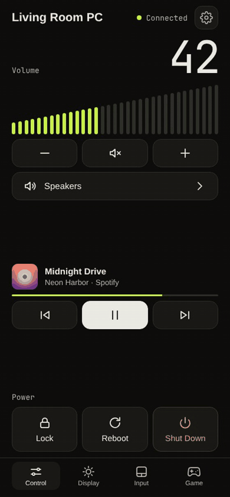

</div>

<table>
  <tr>
    <td align="center">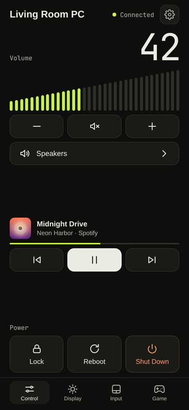<br><sub><b>Control</b></sub></td>
    <td align="center">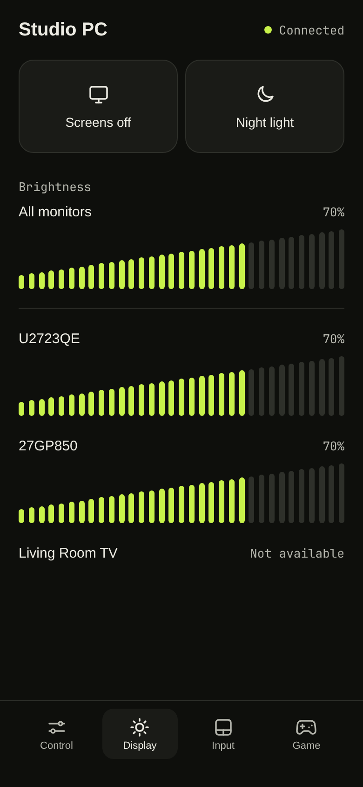<br><sub><b>Display</b></sub></td>
    <td align="center">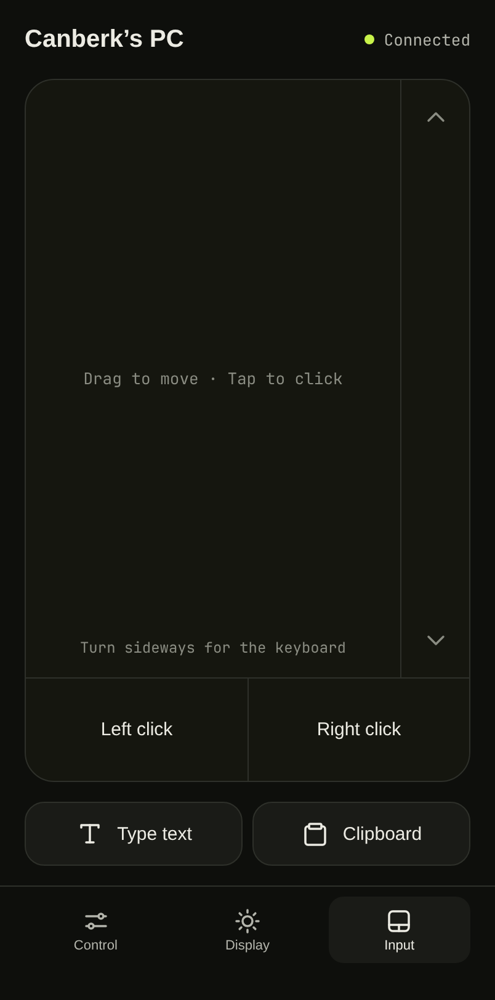<br><sub><b>Input</b></sub></td>
    <td align="center">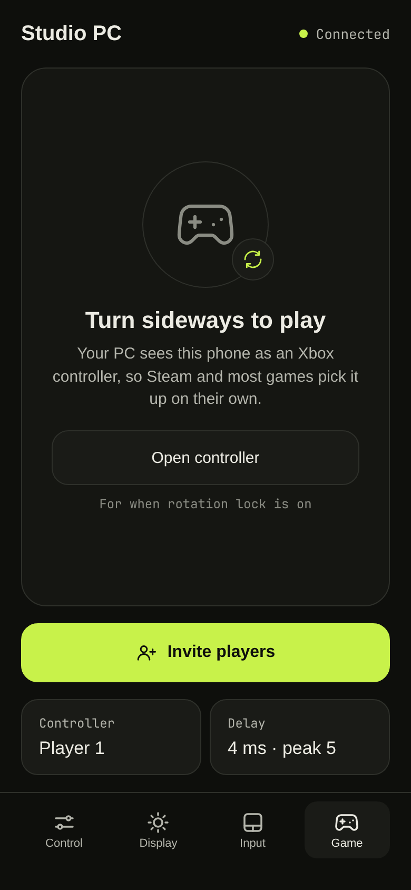<br><sub><b>Game</b></sub></td>
  </tr>
</table>

## Contents

- [What it does](#what-it-does)
- [Get started](#get-started)
- [A tour of the app](#a-tour-of-the-app)
  - [Control](#control): volume, audio output, now playing, power
  - [Display](#display): screens off, night light, brightness
  - [Input](#input): trackpad, keyboard, typing, clipboard
  - [Game](#game): a touch Xbox controller you can rearrange
  - [Party](#party): friends join as players 2 to 4
- [Security](#security)
- [Configuration](#configuration)
- [Themes](#themes)
- [More](#more): uninstall, the `pc-remote` helper, development

## What it does

| | |
| --- | --- |
| 🔊 **Control** | Volume and mute, pick the audio output, Now Playing with cover art and media keys, Lock, Reboot and Shut Down. |
| 🖥️ **Display** | Turn the screens off, toggle the night light, set the brightness of all monitors at once or of each one. |
| 🖱️ **Input** | Hold the phone upright for a trackpad, turn it sideways for a full keyboard. Type text into the PC and pass the clipboard both ways. |
| 🎮 **Game** | Turn sideways for a touch controller the PC sees as an Xbox 360 pad. Move, resize and hide every control. |
| 🎉 **Party** | Friends on your Wi-Fi scan a QR code and join as players 2 to 4, with a controller and nothing else. |
| 🎨 **Themes** | Follows your Omarchy theme live, or bring your own CSS. |
| 🔒 **Access** | One passcode, created on first run, with a one-minute lockout after five wrong tries. Works over Tailscale. |
| 📦 **One binary** | The web app is embedded. No root: input goes through `/dev/uinput`, which systemd gives to the user at the computer. |

## Get started

**You need**

- Omarchy (Hyprland, PipeWire)
- An iPhone on iOS 16.2 or newer, or a recent Android browser

**Install on the PC**

```bash
curl -fsSL https://github.com/canberkbekir/omarchy-remote/releases/latest/download/install.sh | bash
```

This downloads the latest release (checked against its checksums), installs it into `~/.local/bin` with no root needed, and starts setup. To build from source instead, with Go 1.27 or newer (`mise use -g go@latest` works):

```bash
git clone https://github.com/canberkbekir/omarchy-remote.git
cd omarchy-remote
./install.sh
```

Either way, setup walks you through the rest:

1. **A check of the PC.** Anything missing (like `playerctl` for the media controls) is named by the feature it affects, and setup offers to install it.
2. **A few questions:** how your phone connects (same Wi-Fi, Tailscale or both), the name shown in the app, its colors, whether friends can join games, and the passcode: keep the current one (or have one made for you) or choose your own. Press `?` on a question for more detail.
3. **A review** of every change before anything happens, including the ones that ask for your password (installing packages, opening the firewall to your home network, `tailscale serve`).
4. **A QR code and the passcode.** Scan the code with your phone, tap **Share**, then **Add to Home Screen**, and open the new icon.

Run `pc-remote setup` again at any time to change your answers. It starts from your current settings.

To update, run `pc-remote update`. It installs the latest release and restarts the app, and keeps your settings. On Omarchy, setup also offers to do this for you after every `omarchy update`. In a clone, run `git pull && ./install.sh` instead. Versions before v0.1.3 don't have `update` yet, so run the install command above once more.

**Commands**

| | |
| --- | --- |
| `pc-remote setup` | set up, or change settings. `--yes` keeps the current settings without asking; `--help` lists the rest |
| `pc-remote doctor` | check every part (tools, service, firewall, Tailscale) and say how to fix what's wrong |
| `pc-remote passcode` | show the passcode. `--reset` makes a new one, and phones sign in again |
| `pc-remote update` | install the latest release and restart the service. `--check` only says whether there is one |
| `pc-remote version` | show the version |

## A tour of the app

### Control

<table>
  <tr>
    <td width="340">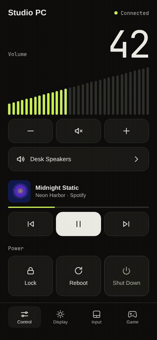</td>
    <td>

- **Volume:** drag anywhere on the meter, or step it with **−** and **+**. The mute button sits between them.
- **Audio output:** tap the output row to switch between speakers, headphones, HDMI and any other sound device.
- **Now Playing:** title, artist, player, cover art and progress for whatever is playing (Spotify, a browser, mpv, …), with previous, play/pause and next.
- **Power:** **Lock** acts right away. **Reboot** and **Shut Down** ask first.

</td>
  </tr>
</table>

### Display

<table>
  <tr>
    <td width="340">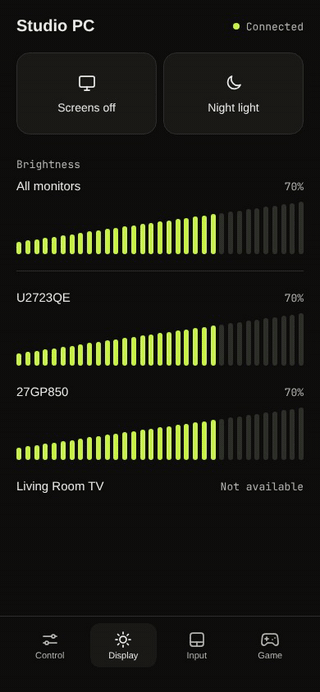</td>
    <td>

- **Screens off** turns every monitor off without locking. Tap again to bring them back.
- **Night light** toggles Omarchy's night light.
- **Brightness** has a slider per monitor, plus **All monitors** when you have more than one. When they differ, the shared slider says *Mixed*.
- Brightness goes over DDC/CI, so monitors that don't support it (like most TVs) say *Not available*.

</td>
  </tr>
</table>

### Input

<table>
  <tr>
    <td width="340">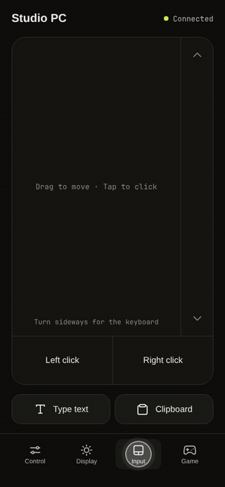</td>
    <td>

**Hold the phone upright for a trackpad.**

- Drag to move the pointer. Faster swipes go further.
- Tap to click, tap with two fingers to right click.
- Scroll with two fingers, or with the strip on the right.
- **Left click** and **Right click** stay pressed while you hold them, so you can drag windows and select text.

**Type text** sends a whole sentence (emoji included) to the window that's active on the PC, with or without Enter.

**Clipboard** shows what's copied on the PC so you can copy it to the phone, and sends text the other way.

</td>
  </tr>
</table>

<p align="center">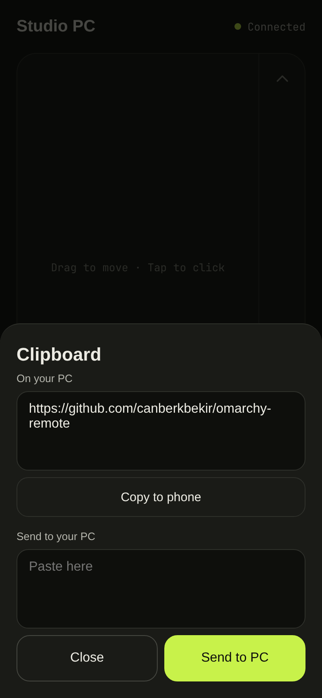</p>

**Turn the phone sideways for a full keyboard.**

<p align="center">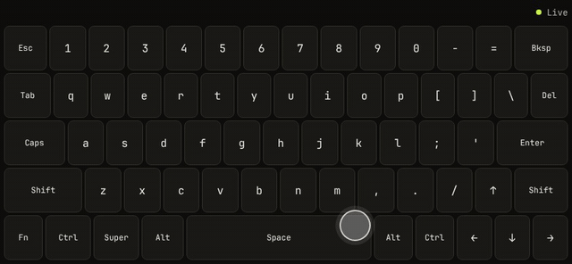</p>

- Every key is a real key on a virtual keyboard, so shortcuts work everywhere, including Hyprland's.
- **Tap a modifier** (Ctrl, Shift, Alt, Super) and it stays down for the next key: tap **Ctrl**, then **c**. Hold it instead to use it like a normal key. The bar at the top shows the combination.
- **Hold Shift** and the keys show what they'll type.
- **Fn** swaps in F1 to F12, Home, End, Page Up and Page Down.
- Several keys can be held at once.

### Game

<table>
  <tr>
    <td width="660">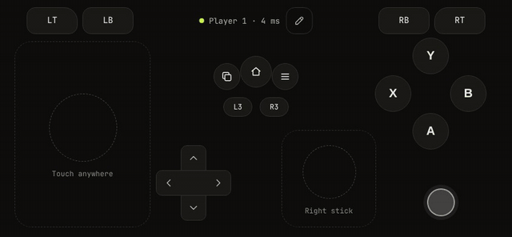</td>
  </tr>
</table>

Open the **Game** tab and turn the phone sideways. The first time, the PC gets a virtual Xbox 360 controller named "PC Remote Gamepad". Steam and games that use SDL pick it up as a standard Xbox 360 controller, with no setup.

- **Sticks float:** touch anywhere in a stick's area and the stick starts under your thumb. A touch on empty space that's closer to the left stick than to any other control starts the left stick too. On the left stick you can go a little past the edge and back without slowing down, and 90% tilt counts as full. The right stick is bigger, for finer aim, and follows your thumb as soon as it passes the edge, so a fast turn stops at once.
- **Swipe to aim:** in the layout editor, tap the right stick and set **Aim** to **Swipe**. A swipe then moves the PC's mouse instead of tilting the stick, so the same swipe always turns the camera the same amount, like a mouse or a phone shooter. **Speed** sets how far. It works in games that take a controller and a mouse together; games that switch to keyboard-and-mouse mode when the mouse moves are better with **Stick**. Party guests always aim with the stick, and their phones can never move the mouse.
- **L3 and R3:** tap a stick, then touch it again and hold. The stick stays clicked while it moves, so you can sprint or melee without letting go. While the left stick is clicked, or the L3 button is held, three quarters of the way out already counts as full tilt, so a thumb drifting back a little doesn't stop a sprint. The L3 and R3 buttons work too.
- **D-pad:** slide between directions. The corners press two at once.
- **Every finger counts:** move, aim, hold a trigger and press a face button at the same time.
- **Rotation lock on?** Tap **Open controller**. It opens sideways anyway, with a close button.
- **Delay** on the Game tab is the measured round trip to the PC, with the worst of the last 15 seconds as the peak. Home Wi-Fi is usually a few milliseconds. Going through Tailscale adds a little. A high peak with a low average means the Wi-Fi drops packets now and then, which you feel as a stutter.

#### Make the layout yours

<table>
  <tr>
    <td width="660">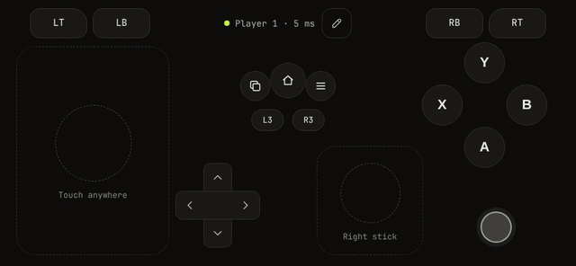</td>
  </tr>
</table>

Tap the pencil on the controller. **Drag** controls to move them, **tap** one to resize it with the slider or **Hide** it (the right stick also chooses how it aims), and tap **Done** to save. **Reset** brings back the default layout.

Layouts are stored on the PC in `~/.config/pc-remote/gamepad.json` as shares of the screen, so a layout works on any phone and survives reinstalling the Home Screen app.

#### Swipe to aim

<table>
  <tr>
    <td width="660">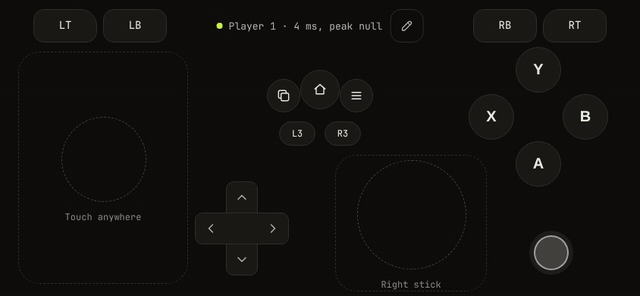</td>
  </tr>
</table>

Tap the pencil, tap the right stick, and set **Aim** to **Swipe**. The right stick's area becomes a swipe pad: swipe to turn, lift and swipe again, like a mouse. Double tap still clicks R3. **Speed** sets how far a swipe turns, and the game's own mouse sensitivity scales it further.

Your app is player 1. If another phone signs in to the app and opens the Game tab, it takes over player 1. Friends join as other players through a [party](#party). iPhones can't vibrate from a web app, so there's no rumble or button feedback on iPhone. Android vibrates briefly on each press.

### Party

<table>
  <tr>
    <td width="340" align="center">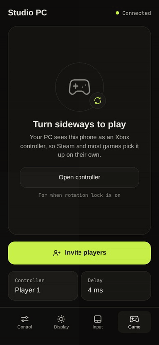<br><sub>On your phone</sub></td>
    <td width="340" align="center">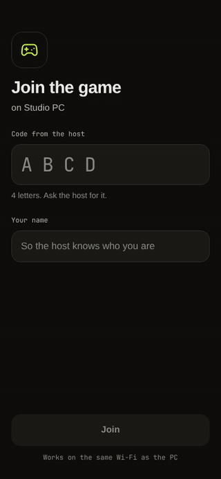<br><sub>On your friend's phone</sub></td>
  </tr>
</table>

On the Game tab, tap **Invite players**. You get a 4-letter code (no numbers, and no I or O, which are easy to mishear), the link, **Copy**, **Share** and a full-screen **QR code**. Friends on your Wi-Fi scan the QR code, or open the link and type the code, then enter their name. Each friend gets their own Xbox controller on the PC.

- **Guests only get a controller.** They join on a separate port (8378), which serves only the join page and the guest controller, accepts only home-network addresses, and is open only while a party runs. Your passcode never leaves your phone.
- **The player list** shows each player and their delay, with a **Remove** button. **New code** changes the code without kicking anyone. **End party** disconnects everyone, unplugs their controllers and closes the guest port.
- **Reconnecting** (phone locked, Wi-Fi blip) keeps the same player. The phone remembers its place until the party ends.
- **Guessing codes** is limited: 5 wrong tries lock a device out for a minute, and 20 wrong tries from all devices together pause joining for a minute.
- Guests can't edit the layout. They get the default one.

Friends' phones need the guest port to get through your [firewall](#firewall); setup offers to open it. Set `guest_port = 0` in `config.toml` to turn parties off.

## Security

This app can type on your keyboard and shut down your computer, so treat access to it like access to the PC.

- **Never expose port 8377 to the internet.** Do not forward it on your router.
- On plain `http://`, your home network can see the passcode. The recommended setup is [Tailscale](https://tailscale.com), which encrypts the connection and also works away from home:

  ```bash
  sudo tailscale serve --bg 8377
  ```

  Then set `access = "tailscale"` in the [config file](#configuration) and restart the service. The app then listens only on this PC, so Tailscale is the only way in. Open `https://<your-pc>.<your-tailnet>.ts.net` on your phone. To keep the home-network address working too, use `access = "both"`. `pc-remote setup` does all of this for you.

- With `access = "lan"`, the app answers only devices with home-network addresses (and Tailscale addresses), even though it listens on every network interface.
- Starting a party opens the guest port (8378) to your home network until the party ends, even with `access = "tailscale"`. It serves only the join page and the guest controller. Set `guest_port = 0` to turn parties off.

### Firewall

Omarchy turns on the `ufw` firewall, which blocks incoming connections unless a rule allows them. Setup checks the rules, and if a port it needs is blocked it offers to allow it, **from your home network only**:

| Port | Needed for |
| --- | --- |
| `8377` | the app, with `access = "lan"` or `"both"`. Tailscale doesn't need it |
| `8378` | parties, when friends join |

To do it yourself (for example after `pc-remote setup --yes`), allow each port from your network's range:

```bash
sudo ufw allow from 192.168.1.0/24 to any port 8377 proto tcp
sudo ufw allow from 192.168.1.0/24 to any port 8378 proto tcp
```

Use your own range: `ip -4 addr` shows it, for example `192.168.1.42/24` means `192.168.1.0/24`. With another firewall (firewalld, nftables), open the same ports to the same range. `pc-remote doctor` tells you if ufw still blocks a port. Never forward these ports on your router.

## Configuration

`pc-remote setup` writes the settings for you. They live in `~/.config/pc-remote/config.toml`, and you can also edit that file by hand. Every setting is optional, and without the file the app uses the defaults below.

```toml
name   = "Studio PC"   # title at the top of the app (default: like "Alex's Desktop")
theme  = "omarchy"     # see Themes below (default: "default")
access = "tailscale"   # "lan", "tailscale" or "both" (default: "lan")
port   = 8377
guest_port = 8378      # where friends join a party; 0 turns parties off
```

| `access` | Listens on | Use it when |
| --- | --- | --- |
| `lan` | every network interface | you open `http://<your-pc-ip>:8377` on home Wi-Fi |
| `tailscale` | this PC only (`127.0.0.1`) | you use `tailscale serve`, as described in [Security](#security) |
| `both` | every network interface | you want both: home Wi-Fi for any phone, and `tailscale serve` for your own phone anywhere |

Restart the service after changing the config: `systemctl --user restart pc-remote-web`. If a setting is misspelled, the service stops and `journalctl --user -u pc-remote-web` shows which one. `pc-remote setup` points out the mistake too, and if you start over it keeps the old file as `config.toml.bak`.

For advanced setups, `listen = "100.64.0.1:8377"` (or the `PC_REMOTE_ADDR` environment variable) sets the exact address and overrides `access` and `port`.

The passcode is kept separately in `~/.config/pc-remote/passcode`, so you can share your config without sharing the passcode. Run `pc-remote setup` to choose your own passcode, or `pc-remote passcode --reset` to get a new random one.

## Themes

<table>
  <tr>
    <td align="center"><br><sub><code>default</code></sub></td>
    <td align="center">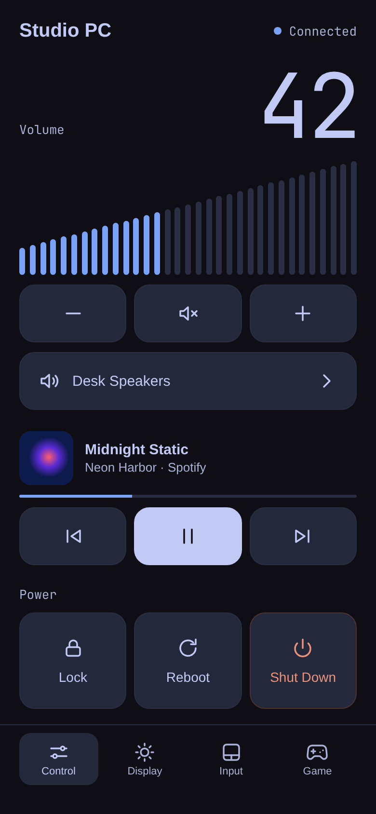<br><sub><code>omarchy</code> (with Tokyo Night)</sub></td>
  </tr>
</table>

Built-in themes:

- `default`: dark with a lime accent.
- `omarchy`: follows your current Omarchy theme. Change the theme on the PC and the phone follows within a few seconds.

The app loads three stylesheets in order, and each one can override the one before:

1. **`base.css`**: layout and structure, built in.
2. **The theme** chosen with `theme = "..."`: colors and fonts.
3. **`~/.config/pc-remote/user.css`**: anything you like, up to a full restyle.

**To make your own theme**, copy [`themes/default.css`](themes/default.css) to `~/.config/pc-remote/themes/<name>.css`, change the colors, and set `theme = "<name>"`. A file in that folder with the same name as a built-in theme replaces it.

Edits to theme files and `user.css` reach an open app within a few seconds, with no restart. Only changing `theme` in `config.toml` needs a restart.

<details>
<summary><b>Theme variables</b></summary>

| Variable | Used for |
| --- | --- |
| `--ground` | page background |
| `--panel` | buttons and cards |
| `--line` | borders |
| `--ink` | main text |
| `--soft` | secondary text |
| `--dim` | hints and unlit ticks |
| `--accent` | sliders, active buttons and the status dot |
| `--risk` | Shut Down and other warnings |
| `--font`, `--mono` | text and number fonts |

A few shades are mixed from these automatically: `--pad`, `--pressed`, `--edge`, `--risk-edge`, `--muted-tick` and `--scrim` (the backdrop behind sheets). Set them yourself to override them.

Every color in Omarchy's `colors.toml` is also available as `--omarchy-<name>`, with underscores turned into dashes (for example `--omarchy-bright-blue`), so your own themes can use Omarchy colors too.

</details>

<details>
<summary><b>Stable names for <code>user.css</code></b></summary>

These IDs and classes won't be renamed without a note in the release, so `user.css` can rely on them:

| Name | What it is |
| --- | --- |
| `#login`, `#control` | the sign-in screen and the main app |
| `#pc-name` | the title |
| `#view-control`, `#view-display`, `#view-input`, `#view-game` | the tabs' pages |
| `#tab-control`, `#tab-display`, `#tab-input`, `#tab-game`, `.tab` | the tab buttons |
| `#volume`, `#monitors` | the volume section and the brightness list |
| `#lock`, `#reboot`, `#shutdown` | the power buttons |
| `#pad`, `#keyboard`, `#gamepad` | the trackpad, the sideways keyboard and the controller |
| `.key`, `.primary`, `.sheet` | buttons, main actions and pop-up sheets |

Anything else in the page may change between versions.

</details>

New themes are welcome as pull requests: add `themes/<name>.css` with a screenshot.

## More

### Uninstall

```bash
systemctl --user disable --now pc-remote-web
rm ~/.config/systemd/user/pc-remote-web.service ~/.local/bin/pc-remote-web ~/.local/bin/pc-remote
rm -f ~/.config/omarchy/hooks/post-update.d/omarchy-remote.hook   # updating along with Omarchy
rm -r ~/.config/pc-remote   # your passcode, config, themes and gamepad layout
```

If setup opened the firewall or set up Tailscale for you, undo that too:

```bash
sudo ufw status numbered      # find the 8377 and 8378 rules, then:
sudo ufw delete <number>      # once per rule, highest number first
sudo tailscale serve --https=443 off
```

### The `pc-remote` helper

`scripts/pc-remote` runs a command inside your running Hyprland session, for example `pc-remote omarchy-system-lock`. The server uses it for session commands. It also works over SSH, so you can use it from an iPhone Shortcuts **Run Script Over SSH** action as well.

### Development

```bash
go test ./...
go build -o pc-remote-web . && ./pc-remote-web
```

The web app is `web/index.html`, `web/app.js` and `web/base.css`, and the guest page is `web/join.html` with `web/join.js`. They are embedded into the binary at build time, along with the built-in themes in `themes/`. Keep scripts in files: the Content-Security-Policy blocks inline scripts and `style=""` attributes.

The screenshots and clips in `docs/` were recorded from the real web app in a phone-sized browser, with a stand-in PC answering its requests.

## License

[MIT](LICENSE)
